<!-- generated by build.py — edit build.py, not this file -->
<picture>
  <source media="(prefers-color-scheme: dark)" srcset="assets/sheet-dark.svg">
  
</picture>

<picture>
  <source media="(prefers-color-scheme: dark)" srcset="assets/strip-writes-dark.svg">
  
</picture>

| DATE | ARTICLE |
| :--- | :--- |
| `2024-10-11` | [Rust CLI 工具替代品](https://gythialy.github.io/awesome-alternatives-cli-in-rust/) |
| `2024-09-24` | [使用 mise 管理开发运行时](https://gythialy.github.io/manage-dev-tools-by-mise/) |
| `2024-06-08` | [基于 Cloudflare 的 Docker 代理](https://gythialy.github.io/cloudflare-docker-proxy/) |
| `2024-06-05` | [从 ColorOS 镜像中提取 apk](https://gythialy.github.io/extract-apk-from-ColorOS-img/) |
| `2024-05-22` | [在 macOS 平台把一加 12 ColorOS 转换为国际版](https://gythialy.github.io/howto-convert-from-ColorOS-to-Global-On-Chinese-Oneplus-12/) |

[All posts →](https://gythialy.github.io/)

<picture>
  <source media="(prefers-color-scheme: dark)" srcset="assets/strip-work-dark.svg">
  
</picture>

| REPO | ABOUT | LANG | ★ |
| :--- | :--- | :---: | ---: |
| [golang-cross](https://github.com/gythialy/golang-cross) | golang cross compiler with CGO | `Shell` | 128 |
| [j60870](https://github.com/gythialy/j60870) | j60870 is a library implementing the IEC 60870-5-104 communication standard. | `Java` | 93 |
| [zerotier-one-moon](https://github.com/gythialy/zerotier-one-moon) | 🐳 A docker image to create ZeroTier moon in one step. | `Shell` | 45 |
| [openmuc](https://github.com/gythialy/openmuc) | OpenMUC is a software framework based on Java and OSGi that simplifies the development of… | `Java` | 33 |

<picture>
  <source media="(prefers-color-scheme: dark)" srcset="assets/strip-foot-dark.svg">
  
</picture>
